<h1 align="center">Hi, I'm  Jaeef 👋</h1>

  Developer from Dhaka, Bangladesh · I build small, local-first tools that solve real problems.

  
  

---

## ⚡ Featured: git-saiyan

  

**[git-saiyan](https://github.com/jaeef/git-saiyan)** turns GitHub contributions into an animated Dragon Ball pixel-art card. It's a GitHub Action, written in TypeScript, that redraws this card every night.

- **10 transformations**, from Kid Goku to Ultra Instinct, driven by lifetime contributions.
- **Ki aura** that grows with your daily or weekly streak.
- **Yearly Dragon Ball hunt**: collect all 7 to summon Shenron.
- **Power-up stages** and a countdown to the next form.
- **Pixel art drawn in code**, animated SVG and GIF output, with no Docker and no native modules.

---

## 🚀 Projects

| Project | What it does | Stack |
| :-- | :-- | :-- |
| [offgrid-md](https://github.com/jaeef/offgrid-md) | Offline document-to-Markdown studio (PDF, Office, images, audio): 100% local, no cloud | React · FastAPI |
| [ghostrecord-obs](https://github.com/jaeef/ghostrecord-obs) | Auto-records exactly one window with OBS, so nothing else on screen is captured | Python |
| [aiub-captcha-solver-extension](https://github.com/jaeef/aiub-captcha-solver-extension) | On-device neural network captcha solver for the AIUB Student Portal | JavaScript |
| [profilepulse](https://github.com/jaeef/profilepulse) | LinkedIn profile auditor with evidence-based scoring, fully client-side | TypeScript |
| [CampusXP](https://github.com/jaeef/summer-25-26-CampusXP) | A radar for campus events and career drives | PHP |
| [Computer-Graphics](https://github.com/jaeef/Computer-Graphics) | Computer Graphics course project at AIUB | C++ |
| [ssh-setup-github-windows](https://github.com/jaeef/ssh-setup-github-windows) | Beginner-friendly guide to setting up SSH for GitHub on Windows | Guide |

---

## 🛠️ Tech stack

  
  
  
  
  
  
  
  
  
  
  
  

---

The card above updates every night from my real GitHub activity.

